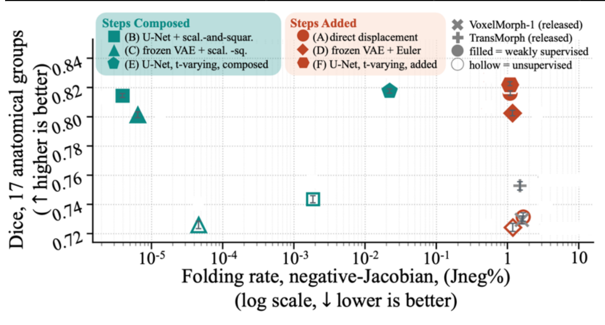

<div align="center">

# A Matched-Protocol Ablation of Deep Brain MRI Registration:<br>Supervision, Step Composition, and Deformation Regularity

**Bo-Wei Lai**<sup>1</sup>, **Ming-Chang Chiang**<sup>1</sup>, **Po-Kai Yang**<sup>2,\*</sup>

<sup>1</sup> Department of Biomedical Engineering, National Yang Ming Chiao Tung University, Taipei, Taiwan<br>
<sup>2</sup> Department of Computer Science, National Yang Ming Chiao Tung University, Hsinchu, Taiwan<br>
<sup>\*</sup> Corresponding author

*The 7th Global Conference on Biomedical Engineering & Annual Meeting of the Taiwanese Society of Biomedical Engineering (GCBME 2026)*

[](docs/GCBME2026_Lai_Chiang_Yang.pdf)
[](#citation)
[-6f42c1.svg)](https://github.com/junyuchen245/TransMorph_Transformer_for_Medical_Image_Registration)
[](LICENSE)



<sub><b>Figure 1.</b> Accuracy against topology for all ten trained runs (115 test subjects, log-scale x-axis).
Every model that <b>composes</b> its steps folds less than every model that <b>adds</b> them, largely independent of Dice.</sub>

</div>

---

## TL;DR

Under one verified protocol and one training recipe, **anatomical supervision moves Dice more than any architecture we tested**, and whether a deformation folds depends on **how successive velocity steps are combined (composed vs. added)**, not on whether a velocity field is integrated at all.

| | Finding | Number |
|---|---|---|
| 1 | Supervision raises VoxelMorph-1 Dice | **+0.085**, better in 115/115 subjects |
| 2 | Stationary velocity + scaling-and-squaring vs. direct displacement | folding **1.080% → 0.000004%** for −0.0015 Dice |
| 3 | Compose vs. add steps (same backbone, parameters, steps) | folding **0.0221% vs 1.078% (48.8×)** |
| 4 | Frozen spatial-VAE encoder (our earlier proposal) | 3× faster (20.0 vs 61.2 ms) but **−0.0132 Dice**, a negative result |

## Abstract

Deformable brain MRI registration aligns corresponding anatomical structures by deforming a reference MRI (atlas) to match each subject's MRI, but differences in evaluation protocols and anatomical supervision can obscure the effects of model design. Using a verified implementation of the official TransMorph IXI atlas-to-subject protocol, we trained ten models under one recipe: four architectures crossed with two supervision levels, plus two U-Net models that predicted a time-varying velocity field over five steps and differed only in whether each step was composed onto the current transformation or added to it. All were evaluated on 115 held-out subjects using Dice, inference time, and folding rate (J<sub>neg</sub>, the percentage of voxels with a nonpositive Jacobian determinant). Supervision raised VoxelMorph-1 Dice by 0.085 in all 115 subjects. Under weak supervision, integrating a stationary velocity field by scaling and squaring cut folding from 1.080% to 0.000004%, from 74,325 folded voxels per subject to fewer than one, for a Dice decrease of 0.0015. With backbone and field type held constant, composing each step rather than adding it reduced folding 48.8-fold, whereas the field type barely mattered when steps were added (1.080% versus 1.078%). A frozen spatial variational autoencoder (VAE) encoder was faster (20.0 versus 61.2 ms) but 0.0132 lower in Dice. Models should therefore be compared under matched supervision and protocols, with the step-combination rule stated and deformation regularity reported alongside Dice.

## Method

**Protocol (locked and verified before any training).** IXI brain MRI from the TransMorph release (403 / 58 / 115 train / val / test; 160×192×224, 1 mm). Atlas is moving and the subject is fixed. 46 FreeSurfer classes are warped as one-hot with trilinear interpolation and then argmax. Dice is averaged over left/right and then over the 17 official anatomical groups. Re-aggregating the official per-subject files reproduces **all eleven published Dice values** (Table 1 of the paper), and rerunning the released VoxelMorph-1 / TransMorph checkpoints reproduces their means with per-subject r = 1.0000.

**Six architectures, one recipe.** All runs use `L = −NCC₉ + λ·Grad(φ) + β·(1 − softDice)` with λ = 1, β ∈ {0, 1}, Adam 1e-4, 100 epochs and the best validation checkpoint.

| Model | Field | How steps are combined | Trainable params |
|---|---|---|---|
| (A) VoxelMorph-1 | displacement | (none, used directly) | 274,387 |
| (B) A + scaling-and-squaring | stationary velocity | composed (2⁷ self-compositions) | 274,387 |
| (C) frozen VAE encoder + S&S | stationary velocity | composed | 678,787 |
| (D) frozen VAE encoder + Euler | time-varying velocity | **added**, 10 steps | 685,699 |
| (E) U-Net, time-varying | time-varying velocity | **composed**, 5 steps | 278,707 |
| (F) U-Net, time-varying | time-varying velocity | **added**, 5 steps | 278,707 |

A–D are trained with and without soft-Dice supervision (8 runs). E and F differ *only* in the step rule (2 runs).

## Results

**Composition × field type** (weak supervision, n = 115; Table 4 of the paper):

| Velocity field | Composed J<sub>neg</sub> (%) | Composed Dice | Added J<sub>neg</sub> (%) | Added Dice | J<sub>neg</sub> ratio |
|---|---|---|---|---|---|
| Stationary, v(x) | 0.000004 (B) | 0.8146 | 1.080 (A) | 0.8161 | 2.7×10⁵ |
| Time-varying, v(x,t) | 0.0221 (E) | 0.8177 | 1.078 (F) | 0.8215 | 48.8 |

Composing invertible maps keeps the map invertible, while an explicit Euler step `x + dt·v(x)` is invertible only where `det(I + dt·∇v) > 0`. Composition is still not sufficient on its own: E folds more than B because five learned Euler factors are not near the identity, whereas scaling-and-squaring divides the field by 2⁷ first. **The step rule decides whether a guarantee is available; the step size decides whether it is obtained.**

Full test-set numbers (Table 2) and paired statistics (Table 3: paired t-test, Wilcoxon, Cohen's d<sub>z</sub>, wins out of 115) are in the [paper](docs/GCBME2026_Lai_Chiang_Yang.pdf) and can be regenerated from `benchmark/results/`.

## Reproducing

Statistics and figures need **no GPU and no data**, only the per-subject CSVs shipped in `benchmark/results/`:

```bash
pip install -r requirements.txt
cd benchmark
python stats_2x2.py            # paired statistics (Table 3)
python make_figure.py          # accuracy-vs-folding plot + per-run Dice / Jneg (Table 2)
```

Retraining needs the IXI data and the official TransMorph repository:

```bash
git clone https://github.com/junyuchen245/TransMorph_Transformer_for_Medical_Image_Registration external/TransMorph
git -C external/TransMorph checkout 6357a1d          # commit the results were produced with
# TransMorph's preprocessed IXI release -> data/IXI_data   (or set IXI_DATA_ROOT)
cd benchmark
python train_softdice.py --arch voxelmorph1_diff --beta 1.0 --lam 1.0 --epochs 100 --seed 0 --tag my_run
python eval_trained.py   ...                           # see run_*.bat for the exact queues
```

Model letter → `--arch`: A `voxelmorph1`, B `voxelmorph1_diff`, E `voxelmorph1_tv_comp`, F `voxelmorph1_tv_sum`. C and D use the frozen VAE in `outputs/ixi_vae/`. Trained checkpoints (~30 GB) are not included. IXI is CC BY-SA 3.0, so the data are not committed here.

<details>
<summary><b>Repository layout</b></summary>

```
reg_common.py              models, losses, scaling-and-squaring, Jacobian
outputs/ixi_vae/           frozen spatial-VAE checkpoint (4 MB) used by models C/D
benchmark/
  common.py                locked protocol: 46 classes, grouped-17 Dice, trilinear warp, Jneg
  train_softdice.py        train any architecture (--arch, --beta, --lam, --seed)
  eval_trained.py          evaluate a trained run on the 115 test subjects
  eval_affine.py, eval_official.py, validate_protocol.py, compare_to_official.py
                           reproduce the published TransMorph benchmark numbers (Table 1)
  stats_2x2.py, stats_interaction.py   paired statistics (Table 3)
  verify_ablation_tables.py            re-derive Tables 2-3 and check them against a manuscript .docx
  make_figure.py           accuracy-vs-folding plot
  run_*.bat                the exact training queues used
  results/                 per-subject test CSVs for every run
  logs/                    training / evaluation logs
paper_figures/             figures as submitted
docs/                      paper PDF and README figure
```
</details>

## Limitations

One dataset, one atlas and one training run per configuration. Seed spread on this data is about 0.0022 Dice, so the 0.0015 integration cost and the 0.0012 C-vs-D gap should be read as not detectable. Comparisons are at matched λ, not matched folding; the follow-up study [Where Should Iterative Registration Refine?](https://github.com/s9988766-creator/IEEE-ISBI2027-iterative-registration) compares models at matched folding. Weakly supervised models are trained on the structures they are scored on.

## Citation

```bibtex
@inproceedings{lai2026matched,
  title     = {A Matched-Protocol Ablation of Deep Brain {MRI} Registration: Supervision, Step Composition, and Deformation Regularity},
  author    = {Lai, Bo-Wei and Chiang, Ming-Chang and Yang, Po-Kai},
  booktitle = {The 7th Global Conference on Biomedical Engineering \& Annual Meeting of the Taiwanese Society of Biomedical Engineering (GCBME)},
  year      = {2026}
}
```

## Acknowledgments

We thank the maintainers of the IXI dataset and the authors of [TransMorph](https://github.com/junyuchen245/TransMorph_Transformer_for_Medical_Image_Registration) for releasing the preprocessed data, code and per-subject results used to verify our evaluation.
